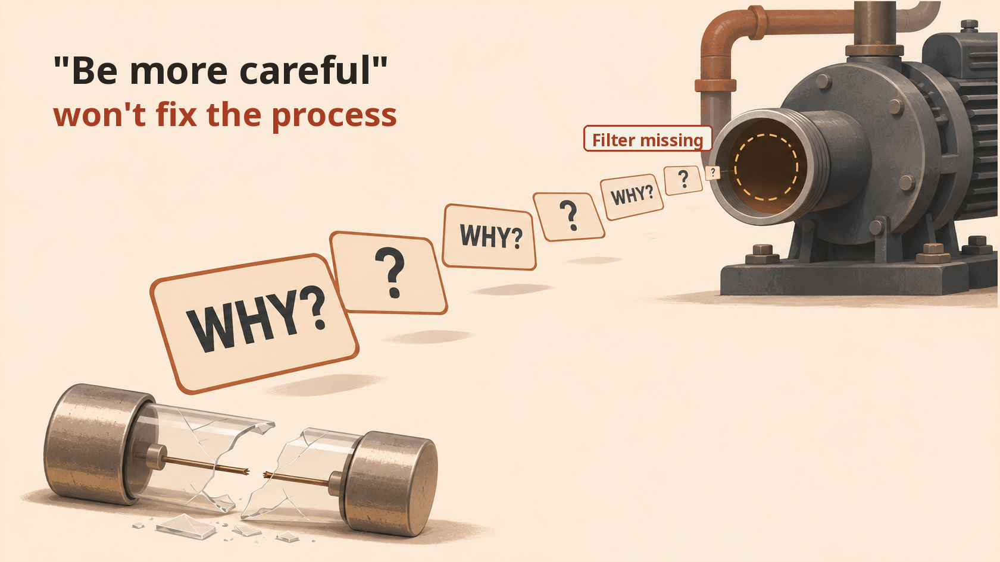
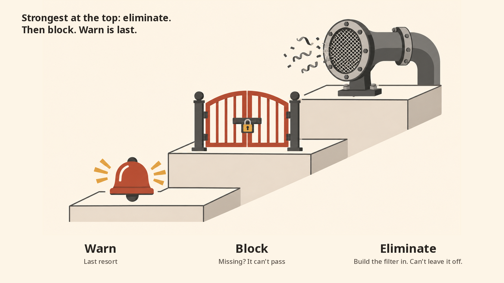

# 给 LLM 代理用的工程防错

三条腿 5 Why、过关检查、再把错误引进去验收。

出错以后，只把这一次的输出改掉是不够的。同一类错误还会再出去：模型写了工具结果里没有的数字，引用了检索集合里没有的来源，或者该调用的工具没有调用，消息却已经发出。

这套用法是把工程里的质量管理，用到 LLM 代理和算法工作流上。先止损，再用可核对的事实写清问题；然后从三条腿追根因——发生、发现、体系；对策优先让错误没法发生，其次在过关前用脚本或检查卡住；最后故意把原来的错误再引进去一次，确认关卡真的拦住，并且正常输入仍能通过。不要把「以后小心点」或「下次把提示词写清楚一点」当成对策。

防错（poka-yoke）不是对策之后的另一步，而是每条对策该采用的形式：先问能不能消除，再问能不能在过关前卡住。每条对策都要落成防错：写进 schema、测试、过关脚本或组装步骤，而不是写在备忘里提醒人注意。

三条腿 5 Why 不是新发明。它来自汽车质量里的问题解决做法，常见于 8D / 全球 8D，以及供应商常用的三条腿 5 Why（3L5Y）：三条腿分别是发生、发现、体系（occurrence, detection, system）。本仓库不是这种做法的源头，做的是把它和防错一起，落到代理流水线的关卡上，并用再引入错误来验收。

方法本身对一般流程同样适用。`examples/` 里既有非代理的虚构例子，也有一则代理故障的虚构例子。所有例子都标明是虚构的，用来演示写法，不是真实事件，也没有使用统计、客户数量或效果数据。

模板在 `templates/`。许可是 MIT，Copyright (c) 2026 wendelxia。

联系：wendelxia@gmail.com

## 本仓库里有什么

- 方法说明（下面第 1 到 7 节，以及「把对策变成防错」）
- 空白表：`templates/5why-template.md`、`templates/poka-yoke-template.md`
- 虚构示例：
  - `examples/03-agent-wrong-kpi-number.md`：指标摘要代理把工具里没有的数字写进了周报（面向代理流水线）
  - `examples/01-wrong-price-tag.md`、`examples/02-report-missing-section.md`：同一套方法用在非代理流程上
- 四张方法示意在 `images/`

---

## 1. 先止损

先挡住正在发生的损害：把受影响的结果标成存疑，告诉会用到这些结果的人，并且先不要再往外送同样的东西。止损和分析可以一起做，但不要还没止损就先讨论原因。

## 2. 用事实写清问题

用一两句话写清，并且要能核对：

- 出了什么事，在哪里发生
- 何时发现、谁发现的
- 预期是什么，实际是什么
- 确切的输入和输出：单号、字段、数值、日志、文件位置、工具返回值、发出的正文

不要只写「出错了」或「结果不对」。

例如（陈述方式的示例，不是真实事件）：「订单 A10882，商品 KH-204 的页面售价应为 199.00，实际显示 19.90。」

再如（同样是虚构的陈述方式）：「代理 `metrics-brief` 在 09:02:28 发出的第 14 周 GMV 为 240,000 EUR，工具 `get_kpi` 在 09:02:11 返回的 `value` 是 182400。」

## 3. 三条腿都要追

只问「为什么会错」，很容易停在「模型胡写」或「人没注意」。这个答案改不了流程，同类错误下次还会来。三条腿要一起问，每条都追到一个能改的原因：

- **A. 发生：** 为什么会出现这个错误结果？
- **B. 发现：** 为什么测试、复核或发布前的检查，没有在它出去之前抓住？
- **C. 体系：** 为什么我们的流程或规范允许它发生？（缺规范、缺检查清单、缺测试要求、职责不清）

对代理流水线，这三问通常对得上：为什么模型或组装步骤写出了这个结果；为什么发送前或发布前的关卡没有拦住；为什么上线规范允许在没有关卡、也没有再引入验收的情况下对外自动发送。

### 证据规则

- 到现场看实物、看事实：读代码、重新跑一遍、看真实输出、看工具记录和发出正文。不要靠猜。
- 每一个回答都必须是可核对的事实，并写上证据（文件位置、日志、输出、测试）。还没核对的，只能标成假设，先验证再往下追。
- 如果原因分叉，每条分叉都要跟。
- 追完以后，从根因倒着读回问题，每一步都能接上「所以」。接不上，就是链子有缺口，要补。

### 何时停下来

- 一直问到一个你能改的流程或体系原因。通常是 3 到 6 问，不必恰好 5 问。
- 不要停在人身上（「我疏忽了」「我忘了」），也不要停在「模型就是会幻觉」。接着问：流程为什么会放行。
- 自问：如果把这个原因拿掉，问题还会不会再来？还会，就继续问。

## 4. 对策

三条腿各自至少一条对策，打在根因上，不要只修表面：

- **A. 发生：** 改掉造成错误的原因（代码、规则、数据、配置、组装步骤、输出格式）。
- **B. 发现：** 补上当时缺的那道检查（用真实输入做的测试、边界值测试、断言、对照工具结果的过关脚本）。
- **C. 体系：** 改规范本身（检查清单上的一项、发布门槛、制度）。

每条对策都要落成防错，而不是写完对策再另做一步。优先级：先消除，再在过关前卡住。永远不要用「以后小心点」或「下次把提示词写清楚一点」当对策。

## 5. 用复现来验收

- 先穷举这一类错误的组合表（输入状态 × 条件 × 期望结果），表里每一格都有一条测试。然后再引入原错误。不要只补已经报出来的那一行。
- 再跑原问题：原来的错误没有了。同时跑既有的回归集，前后结果逐条对比；有变化的每条都要说明是修正还是变坏。
- 组合表里的测试要写进回归集，每次发布都跑，不是上线那一次验完就算。
- 正常输入要拿一批样本跑，记下误拦了几条，不要只测一条「能通过」的例子。
- 关卡失败即拦（fail closed）：工具结果缺失、工具报错或超时、检查脚本报错或超时，一律当作不通过，不能默认放行。

## 6. 写进规范，再横向查一遍

- 把新的检查或规则写进项目文档、测试和发布清单，让以后的工作还在。
- 横向排查：同一类错误在别处有没有（其他指标、其他会自动发数字或对外答复的入口），有就一起改。
- 把这次分析留在项目里，便于以后查阅。

## 7. 记录格式

每个错误写一张表，字段如下：问题、腿、第 1 到 n 问、证据、根因、对策、验收、写进了哪里。然后再用几句平常的话写摘要：根因是什么、改了什么所以它不能再以同样方式出去、还有什么没做完。

空白表见 `templates/5why-template.md`。

---

## 把对策变成防错

这不是对策写完之后再做的另一步。对每个根因，或流程里每个容易出错的步骤，对策本身先问：能不能让这类错误根本没法发生？不能的话，能不能在过关前用脚本或检查把它卡住？不要接受「以后小心点」（无论是人对自己说，还是写在提示词或 AI 建议里）。

能做到的最高档就用哪一档：

1. **消除：** 错误没法发生（先把输入规整再匹配、限制格式、由系统或模板生成而不是由模型手写、只保留一个数据来源）。能把自由文本换成封闭字段或模板，就不要写解析规则去追自由文本。
2. **卡住：** 错误一出现，流程就停（过关脚本拒绝、格式校验失败、该有的检查缺失就硬停、结果与工具值冲突就停下来等人处理）。
3. **示警：** 允许继续，但必须醒目标出（报告里标记该项，清单上显示为未通过）。

优先消除，其次卡住，再不行才示警。

把这道关口写进代码、测试、过关脚本或格式约束里，不要只写在说明里。并在项目规范和检查清单里记下它在哪（文件名或检查名）。

关卡失败即拦（fail closed）：工具结果缺失、工具报错或超时、检查脚本报错或超时，一律当作不通过，不能默认放行。

验收是必做的：先列出这一类错误的组合表，表里每一格都有测试；再引入原错误，确认它按设计被消除、被卡住或被标出。这些测试进入回归集，每次发布都跑。正常输入要成批跑，并记下误拦条数。

每道关口记录：错误类型、档次（消除 / 卡住 / 示警）、做在哪里、验收证据（再引入后被抓住）、还有哪些需要人签字。空白表见 `templates/poka-yoke-template.md`。

---

## 示例说明

`examples/` 里的案例全部是为了演示写法而编的，标题都标了「示例（虚构）」。不要把它们当成真实事件，也不要当成已验证的效果或使用统计。若你先看代理流水线，建议从 `examples/03-agent-wrong-kpi-number.md` 读起。

---

# Engineering error-proofing for LLM agents

Three-legged 5 Why, a gate, and a re-injection test.

After an error, fixing only the output in front of you is not enough. The same class of error can go out again: the model writes a number that was not in the tool result, cites a source that was not in the retrieval set, or skips a tool it should have called, and the message is already sent.

This guide takes quality methods from engineering and applies them to LLM agents and algorithm workflows. Contain the damage, then write a problem statement that can be checked against facts; trace root causes on three legs — occurrence, detection, and system; prefer preventing the error, then catching it at a gate with a script or a check; finally, deliberately reintroduce the original error and confirm the gate holds, and that valid inputs still pass. Do not treat "be more careful" or "write a clearer prompt next time" as a countermeasure.

Error-proofing (poka-yoke) is not a step after the countermeasures. It is the form each countermeasure should take: first ask whether the error can be eliminated, then whether a gate can block it. Each countermeasure must be realised as error-proofing: in a schema, a test, a gate script, or an assembly step — not a note that reminds someone to pay attention.

The three-legged 5 Why is not a new invention. It comes from automotive problem-solving practice, commonly in 8D / Global 8D and in the three-legged 5 Why (3L5Y) used by suppliers, where the three legs are occurrence, detection, and system. This repository is not the source of that method. What it does is put the method, together with error-proofing, into gates on an agent pipeline, and verify them by reintroducing the error.

The method also applies to ordinary processes. `examples/` includes fictional non-agent cases and one fictional agent failure. Every example is labelled fictional. They are there to show the format. They are not real events, and they are not usage statistics, client counts, or performance results.

Templates are in `templates/`. The license is MIT, Copyright (c) 2026 wendelxia.

Contact: wendelxia@gmail.com

## What is in this repository

- The method (sections 1–7 below, and "Turning countermeasures into error-proofing")
- Blank forms: `templates/5why-template.md`, `templates/poka-yoke-template.md`
- Fictional examples:
  - `examples/03-agent-wrong-kpi-number.md`: a metrics-brief agent posts a KPI figure that was not in the tool result (for agent pipelines)
  - `examples/01-wrong-price-tag.md` and `examples/02-report-missing-section.md`: the same method on non-agent processes
- Four simple pictures of the method in `images/`

## 1. Contain

Stop the damage first: mark affected outputs as suspect, tell whoever relies on them, and do not send more of the same. Analysis can start in parallel, but do not discuss causes before containment is underway.

## 2. Problem statement (facts, measured)

In one or two sentences, write something that can be checked:

- What went wrong, and where
- When it was found, and by whom
- Expected versus actual
- Exact inputs and outputs: record ids, fields, values, logs, file locations, tool results, and the text that was sent

Do not write only "it was wrong."

Example of the form (not a real event): "Order A10882, product KH-204: the listed price should have been 199.00, but the page showed 19.90."

Another example of the form (also fictional): "Agent `metrics-brief` posted week-14 GMV as 240,000 EUR at 09:02:28; the `get_kpi` tool had returned `value=182400` at 09:02:11."

## 3. Three legs — follow all three

If you only ask "why did this go wrong?", the chain often stops at "the model hallucinated" or "someone was not careful." That answer does not change the process, so the same class of error can return. Ask all three, and follow each to a cause you can change:

- **A. Occurrence:** Why did the wrong result happen?
- **B. Detection:** Why did tests, review, or the release check not catch it before it went out?
- **C. System:** Why did our process or norms allow this (missing norm, checklist, test policy, or unclear ownership)?

On an agent pipeline, the three questions usually map to: why the model or the assembler produced this result; why the pre-send or release gate did not catch it; and why the launch norms allowed automatic sending without a gate or a re-injection test.

### Evidence rules

- Go to the actual place, the actual thing, and the actual facts: read the code, rerun, look at the real output, the tool record, and the text that was sent. Do not answer from the armchair.
- Every answer must be a verified fact, with evidence (file location, log, output, test). If it is not yet verified, label it a hypothesis and test it before building on it.
- If causes branch, follow each branch.
- When the chain is done, read it backwards from the root cause to the problem with "therefore." If a link does not follow, there is a gap — fix the chain.

### Stop rules

- Keep asking until you reach a process or system cause you can change. That is usually 3–6 whys, not a fixed five.
- Never stop at a person ("I was careless", "I forgot"), and never stop at "models hallucinate." Ask why the process allowed it.
- Check: if this cause were removed, would the problem recur? If yes, keep going.

## 4. Countermeasures

At least one per leg, aimed at the root cause, not only the symptom:

- **A. Occurrence:** Fix the cause (code, rule, data, config, assembler, output schema).
- **B. Detection:** Add the check that would have caught it (a test on real inputs, a boundary-value test, an assertion, a gate script that compares the output with the tool result).
- **C. System:** Change the norm itself (a checklist item, a release gate, a policy).

Each countermeasure must be realised as error-proofing, not followed by a separate error-proofing step. Hierarchy: eliminate first, then block at a gate. Never use "be more careful" or "write a clearer prompt next time" as a countermeasure.

## 5. Verify with data

- First enumerate the combinations for this class of error (input state × condition × expected result), with one test per cell. Then reintroduce the original error. Do not only add the row that was already reported.
- Rerun the original case: the original error is gone. Also run the existing regression set and compare each result before and after; for every change, say whether it is a fix or a regression.
- Put the combination-table tests into the regression set and run them on every release, not only at the first launch.
- Run a batch of valid inputs and record how many were blocked by mistake. Do not rely on a single passing example.
- The gate fails closed: if the tool result is missing, the tool errors or times out, or the check script errors or times out, treat it as a failure and do not let the work through.

## 6. Standardise and look sideways

- Write the new check or rule into the project's documents, tests, and release checklist so it remains in later work.
- Look sideways: search for the same class of error elsewhere (other KPIs, other automatic posting or reply paths) and fix those too.
- Keep the analysis in the project so it can be read later.

## 7. Record format

For each error, a table: problem | leg | why 1..n | evidence | root cause | countermeasure | verification | where it was written in. Then a short plain-language summary: the root causes, what was changed so it cannot get out the same way, and what is still open.

A blank form is in `templates/5why-template.md`.

## Turning countermeasures into error-proofing

This is not a further step after the countermeasures have been written. For each root cause, or each risky step, the countermeasure itself starts with: can we make this class of error impossible? If not, can a script or a check catch it and hold the gate? Do not accept "be more careful" (from a person, from a prompt, or from an AI suggestion) as a countermeasure.

Use the strongest level that is feasible:

1. **Eliminate:** the error cannot occur (normalise inputs before matching, constrain formats, generate from a template or a tool instead of letting the model hand-write the value, keep a single source of truth). If free text can be replaced by a closed field or a template, do not write a parser to chase free text.
2. **Block:** the error stops the work (a release script refuses, schema validation fails, a required check is missing so the run hard-stops, a conflict with the tool value halts and waits for a person).
3. **Alert:** it may continue, but it is flagged loudly (the report marks the item; the checklist shows it as not passed).

Prefer 1 over 2 over 3.

Put the guard in code, a test, a gate script, or a schema — not only in a note. Record where it lives (file name or check name) in the project's norms and checklist.

The gate fails closed: if the tool result is missing, the tool errors or times out, or the check script errors or times out, treat it as a failure and do not let the work through.

Verification is required: first enumerate the combination table for this class of error, with one test per cell; then reintroduce the original error and confirm the guard eliminates, blocks, or alerts as designed. Those tests go into the regression set and run on every release. Run a batch of valid inputs and record how many were blocked by mistake.

Per guard, record: error class | level (eliminate / block / alert) | where it was implemented | verification evidence (error reintroduced, then caught) | anything left to human sign-off. A blank form is in `templates/poka-yoke-template.md`.

## About the examples

Every case in `examples/` was written to show the format. Each title is marked "Example (fictional)". Do not treat them as real events, or as proven results or usage statistics. If you are starting from an agent pipeline, begin with `examples/03-agent-wrong-kpi-number.md`.

## Illustrations

Four simple pictures for the method: a cover, the fuse-to-filter "why" chain, the three legs (occurrence, detection, system), and the fix order (eliminate, then block, then warn).

这四张图是方法的简单示意：封面、保险丝到滤网的追问链、三条腿，以及对策三档。

