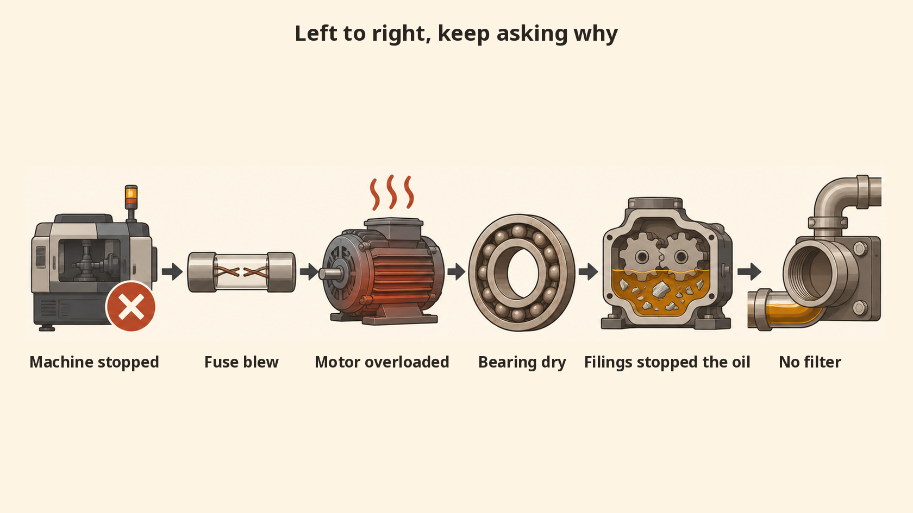
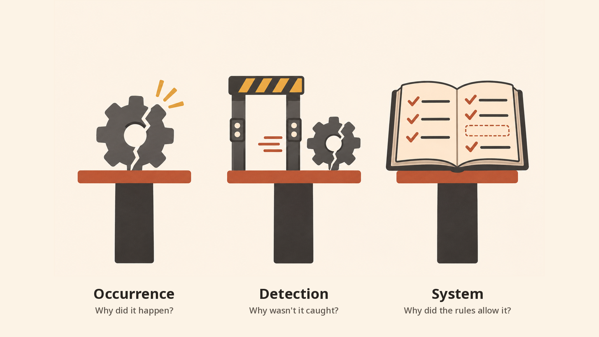

# 三条腿 5 Why + 防错

出错以后，只把眼前这个问题改掉是不够的。目标是：同一类错误不能再以同样的方式出去。

这份材料说明一套用法：先止损，再用事实写清问题；然后从三条腿追根因——发生、发现、体系；每条腿都要有证据，追到能改的流程或规则为止；对策优先让错误没法发生，其次在过关前用脚本或 AI 检查卡住，绝不把「以后小心点」当成对策；改完要把错误再引进去一次做验收，再写进项目规范，并横向查一遍别处有没有同类漏洞。

防错（poka-yoke）接在对策后面：把每条对策做成检查，写进脚本、测试或 AI 步骤里，过关时过不去就卡住，而不是写在备忘里提醒人注意。

模板在 `templates/`，虚构示例在 `examples/`，许可见 `LICENSE`（MIT，版权人 wendelxia）。

---

## 1. 先止损

先挡住正在发生的损害：把受影响的结果标成存疑，告诉会用到这些结果的人，并且先不要再往外送同样的东西。止损和分析可以一起做，但不要还没止损就先讨论原因。

## 2. 用事实写清问题

用一两句话写清，并且要能核对：

- 出了什么事，在哪里发生
- 何时发现、谁发现的
- 预期是什么，实际是什么
- 确切的输入和输出：单号、字段、数值、日志、文件位置

不要只写「出错了」或「结果不对」。

例如：「订单 A10882，商品 KH-204 的页面售价应为 199.00，实际显示 19.90。」这是陈述方式的示例，不是真实事件。

## 3. 三条腿都要追

只问「为什么会错」，很容易停在「人没注意」。这个答案改不了流程，同类错误下次还会来。三条腿要一起问，每条都追到一个能改的原因：

- **A. 发生：** 为什么会出现这个错误结果？
- **B. 发现：** 为什么测试、复核或发布前的检查，没有在它出去之前抓住？
- **C. 体系：** 为什么我们的流程或规范允许它发生？（缺规范、缺检查清单、缺测试要求、职责不清）

### 证据规则

- 到现场看实物、看事实：读代码、重新跑一遍、看真实输出。不要靠猜。
- 每一个回答都必须是可核对的事实，并写上证据（文件位置、日志、输出、测试）。还没核对的，只能标成假设，先验证再往下追。
- 如果原因分叉，每条分叉都要跟。
- 追完以后，从根因倒着读回问题，每一步都能接上「所以」。接不上，就是链子有缺口，要补。

### 何时停下来

- 一直问到一个你能改的流程或体系原因。通常是 3 到 6 问，不必恰好 5 问。
- 不要停在人身上（「我疏忽了」「我忘了」）。接着问：流程为什么会放行。
- 自问：如果把这个原因拿掉，问题还会不会再来？还会，就继续问。

## 4. 对策

三条腿各自至少一条对策，打在根因上，不要只修表面：

- **A. 发生：** 改掉造成错误的原因（代码、规则、数据、配置）。
- **B. 发现：** 补上当时缺的那道检查（用真实输入做的测试、边界值测试、断言、复核步骤）。
- **C. 体系：** 改规范本身（检查清单上的一项、发布门槛、制度）。

优先级：先防止发生，再在过关前检查拦住。永远不要用「以后小心点」当对策。

## 5. 用复现来验收

- 再跑一遍：原来的错误没有了，也没有带出新的问题。
- 证明发现这侧的对策真的有效：故意把原来的错误（或同类变体）再引进去一次，确认新的检查能抓住。
- 同时确认正常、有效的输入仍能通过，不会被误拦。

## 6. 写进规范，再横向查一遍

- 把新的检查或规则写进项目文档、测试和发布清单，让以后的工作还在。
- 横向排查：同一类错误在别处有没有，有就一起改。
- 把这次分析留在项目里，便于以后查阅。

## 7. 记录格式

每个错误写一张表，字段如下：问题、腿、第 1 到 n 问、证据、根因、对策、验收、写进了哪里。然后再用几句平常的话写摘要：根因是什么、改了什么所以它不能再以同样方式出去、还有什么没做完。

空白表见 `templates/5why-template.md`。

---

## 把对策变成防错

对每个根因，或流程里每个容易出错的步骤，先问：能不能让这类错误根本没法发生？不能的话，能不能在过关前用脚本或 AI 检查把它卡住？不要接受「以后小心点」（无论是人对自己说，还是 AI 写在建议里）。

能做到的最高档就用哪一档：

1. **消除：** 错误没法发生（先把输入规整再匹配、限制格式、由系统生成而不是手写、只保留一个数据来源）。
2. **卡住：** 错误一出现，流程就停（过关脚本拒绝、格式校验失败、该有的检查缺失就硬停、结果冲突就停下来等人处理）。
3. **示警：** 允许继续，但必须醒目标出（报告里标记该项，清单上显示为未通过）。

优先消除，其次卡住，再不行才示警。

把这道关口写进代码、测试、过关脚本或格式约束里，不要只写在说明里。并在项目规范和检查清单里记下它在哪（文件名或检查名）。

验收是必做的：再引入一次错误（或同类变体），确认它按设计被消除、被卡住或被标出；再确认正常输入仍能通过。

每道关口记录：错误类型、档次（消除 / 卡住 / 示警）、做在哪里、验收证据（再引入后被抓住）、还有哪些需要人签字。空白表见 `templates/poka-yoke-template.md`。

---

## 示例说明

`examples/` 里的案例全部是为了演示写法而编的，标题都标了「示例（虚构）」。不要把它们当成真实事件。

---

# Three-legged 5 Why + error-proofing

After an error, fixing only the case in front of you is not enough. The aim is that the same class of error cannot get out the same way again.

This guide describes one way of working: contain the damage, then write a problem statement that can be checked against facts; trace root causes on three legs — occurrence, detection, and system; require evidence on every leg, and stop only at a process or rule you can change; prefer preventing the error, then catching it at a gate with a script or an AI check, and never treat "be more careful" as a countermeasure; verify by reintroducing the error, write the change into the project's norms, and look sideways for the same class of gap.

Error-proofing (poka-yoke) comes after the countermeasures: turn each one into a check that lives in a script, a test, or an AI step, so work cannot pass the gate until it clears — not a note that reminds someone to pay attention.

Templates are in `templates/`. Worked examples in `examples/` are fictional. The license is MIT, Copyright (c) 2026 wendelxia.

## 1. Contain

Stop the damage first: mark affected outputs as suspect, tell whoever relies on them, and do not send more of the same. Analysis can start in parallel, but do not discuss causes before containment is underway.

## 2. Problem statement (facts, measured)

In one or two sentences, write something that can be checked:

- What went wrong, and where
- When it was found, and by whom
- Expected versus actual
- Exact inputs and outputs: record ids, fields, values, logs, file locations

Do not write only "it was wrong."

Example of the form (not a real event): "Order A10882, product KH-204: the listed price should have been 199.00, but the page showed 19.90."

## 3. Three legs — follow all three

If you only ask "why did this go wrong?", the chain often stops at "someone was not careful." That answer does not change the process, so the same class of error can return. Ask all three, and follow each to a cause you can change:

- **A. Occurrence:** Why did the wrong result happen?
- **B. Detection:** Why did tests, review, or the release check not catch it before it went out?
- **C. System:** Why did our process or norms allow this (missing norm, checklist, test policy, or unclear ownership)?

### Evidence rules

- Go to the actual place, the actual thing, and the actual facts: read the code, rerun, look at the real output. Do not answer from the armchair.
- Every answer must be a verified fact, with evidence (file location, log, output, test). If it is not yet verified, label it a hypothesis and test it before building on it.
- If causes branch, follow each branch.
- When the chain is done, read it backwards from the root cause to the problem with "therefore." If a link does not follow, there is a gap — fix the chain.

### Stop rules

- Keep asking until you reach a process or system cause you can change. That is usually 3–6 whys, not a fixed five.
- Never stop at a person ("I was careless", "I forgot"). Ask why the process allowed it.
- Check: if this cause were removed, would the problem recur? If yes, keep going.

## 4. Countermeasures

At least one per leg, aimed at the root cause, not only the symptom:

- **A. Occurrence:** Fix the cause (code, rule, data, config).
- **B. Detection:** Add the check that would have caught it (a test on real inputs, a boundary-value test, an assertion, a review step).
- **C. System:** Change the norm itself (a checklist item, a release gate, a policy).

Hierarchy: prevent first, then catch it at a gate. Never use "be more careful" as a countermeasure.

## 5. Verify with data

- Rerun: the original error is gone, and nothing else broke.
- Prove the detection countermeasure works: deliberately reintroduce the bug (or a same-class variant) and confirm the new check catches it.
- Confirm that normal, valid inputs still pass and are not blocked by mistake.

## 6. Standardise and look sideways

- Write the new check or rule into the project's documents, tests, and release checklist so it remains in later work.
- Look sideways: search for the same class of error elsewhere and fix those too.
- Keep the analysis in the project so it can be read later.

## 7. Record format

For each error, a table: problem | leg | why 1..n | evidence | root cause | countermeasure | verification | where it was written in. Then a short plain-language summary: the root causes, what was changed so it cannot get out the same way, and what is still open.

A blank form is in `templates/5why-template.md`.

## Turning countermeasures into error-proofing

For each root cause, or each risky step, ask: can we make this class of error impossible? If not, can a script or an AI check catch it and hold the gate? Do not accept "be more careful" (from a person or from an AI suggestion) as a countermeasure.

Use the strongest level that is feasible:

1. **Eliminate:** the error cannot occur (normalise inputs before matching, constrain formats, generate instead of hand-write, keep a single source of truth).
2. **Block:** the error stops the work (a release script refuses, schema validation fails, a required check is missing so the run hard-stops, conflicting results halt and wait for a person).
3. **Alert:** it may continue, but it is flagged loudly (the report marks the item; the checklist shows it as not passed).

Prefer 1 over 2 over 3.

Put the guard in code, a test, a gate script, or a schema — not only in a note. Record where it lives (file name or check name) in the project's norms and checklist.

Verification is required: deliberately reintroduce the error (or a same-class variant) and confirm the guard eliminates, blocks, or alerts as designed. Confirm that valid inputs still pass.

Per guard, record: error class | level (eliminate / block / alert) | where it was implemented | verification evidence (error reintroduced, then caught) | anything left to human sign-off. A blank form is in `templates/poka-yoke-template.md`.

## About the examples

Every case in `examples/` was written to show the format. Each title is marked "Example (fictional)". Do not treat them as real events.

## Illustrations

Four simple pictures for the method: a cover, the fuse-to-filter "why" chain, the three legs (occurrence, detection, system), and the fix order (eliminate, then block, then warn).

这四张图是方法的简单示意：封面、保险丝到滤网的追问链、三条腿，以及对策三档。

